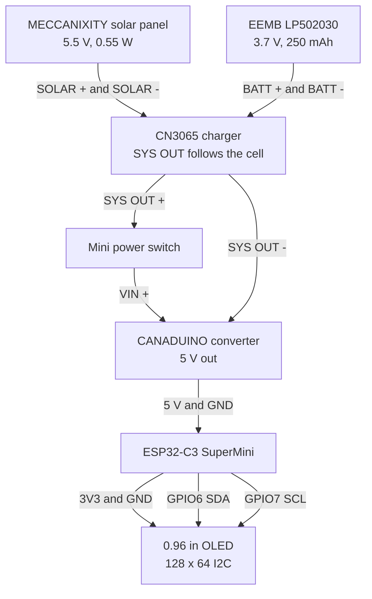
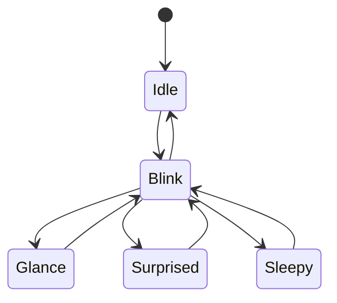

# solareyes

Small rechargeable keychain that plays animated eyes on a 0.96" OLED and charges from a solar panel. Version 0.1 is a bench MVP: expressive eyes, a LiPo, onboard solar charging, and no Wi-Fi, Bluetooth, app, or account.

The face is about 70 x 70 mm because the solar panel sets the size. This is a badge-style keychain, larger than the OLED by itself.

## Project Status

Version 0.1 is in progress and is being wired on the bench. The ESP32-C3 SuperMini and perfboard are already on hand. Pack prices that are still unknown are left blank below.

This version is a maker-video MVP. It is meant to boot, show a few eye expressions, blink on its own, run from the battery, and fit in a printed shell.

## System Overview

A solar panel feeds a CN3065 charger, which charges a 250 mAh LiPo. The charger SYS pin follows the cell voltage and feeds a 5 V boost converter through a switch. The converter powers the ESP32-C3 SuperMini on its 5 V pin. The SuperMini's 3.3 V rail powers the OLED. The display is a 128 x 64 I2C panel on SDA GPIO6 and SCL GPIO7.

Firmware is a small Arduino sketch. It draws eyes with U8g2 and steps through idle, blink, glance, surprised, and sleepy using `millis()`. Nothing on the board joins a network.

## Wiring

SYS OUT follows the LiPo voltage, about 3.0 V to 4.2 V while the cell is in normal use. The CANADUINO module is what makes the regulated 5 V rail. The OLED is powered from the SuperMini 3.3 V pin.



### Point-to-point

| From | To | Connection notes |
|---|---|---|
| Solar panel + / - | CN3065 SOLAR + / - | Charging input. Measure panel open-circuit voltage in full sun before connecting, and confirm it is inside the charger board's input rating. |
| LiPo + / - | CN3065 BATT + / - | Check JST polarity against the board silk and the cell's red lead before mating the plug. |
| CN3065 SYS OUT + | Switch, then converter VIN + | Switch is in series with SYS OUT + only, so the cell can still charge while the gadget is off. |
| CN3065 SYS OUT - | Converter GND | Battery return. |
| Converter 5 V / GND | ESP32-C3 5 V / GND | Meter the converter first. Connect the SuperMini only after the output is a steady 5.0 V unloaded and with a small load. |
| ESP32-C3 3V3 / GND | OLED VCC / GND | Display power comes from the SuperMini 3.3 V rail. |
| ESP32-C3 GPIO6 | OLED SDA | I2C data. The sketch calls `Wire.begin(6, 7)`. |
| ESP32-C3 GPIO7 | OLED SCL | I2C clock. |

GPIO6 and GPIO7 are the pins for this build. They are not a universal default across ESP32-C3 board definitions.

### Before you apply power

1. Meter the solar panel open-circuit voltage in full sun. A panel sold as 5.5 V can sit higher than its label with no load.
2. Confirm battery polarity and that the pouch is not creased, punctured, or pinched. Read the charge-current resistor on the CN3065 and keep USB charge current near 0.5C for this cell, about 125 mA. A charger module can be set much higher than the panel's 100 mA.
3. Power the 5 V converter from SYS OUT and confirm 5.0 V before the SuperMini is attached.
4. Leave the SuperMini USB-C cable unplugged whenever the converter is connected to the 5 V pin. Those two sources share that rail. Use USB only while the converter output is disconnected, for the first OLED bring-up.

## Bill of Materials

Prices are CAD, per pack or listing. A multi-pack is priced as one purchase, not per piece.

| Item | Notes | Qty | Price / pack |
|---|---|---:|---|
| 0.96" yellow/blue OLED | 128 x 64, I2C. Confirm SSD1306 or SH1106 before choosing the U8g2 constructor. | 1 | `C$ _____` |
| ESP32-C3 SuperMini | 3.3 V dev board. | 1 | Owned |
| CN3065 solar charger | Solar LiPo charge module, Micro-USB. | 1 | `C$ _____` |
| EEMB LP502030 LiPo | 3.7 V, 250 mAh, about 20.5 x 32 x 5.3 mm. | 1 | `C$ _____` |
| MECCANIXITY solar panel | 5.5 V, 0.55 W, 100 mA, about 70 x 70 mm. | 1 | `C$ _____` |
| CANADUINO 5 V converter | 3-15 V in, 5 V at up to 600 mA. Sold as a 3-pack. | 1 | C$12.89 |
| Perfboard / protoboard | Main electronics carrier. | 1 | Owned |
| Pre-formed jumper wire kit | Cut and solder on the perfboard. | As needed | `C$ _____` |
| 3D-printed enclosure | Front bezel, rear shell, access cutouts. | 1 set | `C$ _____` |
| Standoffs, insulation, fasteners | Mount the OLED and perfboard. Keep the pouch insulated. | As needed | `C$ _____` |
| Mini on/off switch | Recommended. Placed in series with SYS OUT +. | 1 | `C$ _____` |

**Cost to complete.** Amazon order total: `C$ __________`. Additional hardware / print cost: `C$ __________`.

## Required Tools

| Tool | Purpose |
|---|---|
| Soldering iron | Perfboard joints for power and I2C |
| Multimeter | Panel open-circuit voltage, polarity, and the 5.0 V rail |
| Wire stripper / cutter | Jumper leads |
| 3D printer | Bezel and rear shell, after a dry-fit |
| Arduino IDE | Build and upload `solar_eyes_v0_1.ino` |

## Build and Verification Order

1. Run the ESP32-C3 and OLED from USB only. Confirm I2C, orientation, and the eye cycle. Keep the 5 V converter disconnected during this step.
2. Measure the solar panel open-circuit voltage in full sun and compare it with the CN3065 board's input rating.
3. Check charger wiring, battery polarity, and the charge-current setting for the 250 mAh cell.
4. Power the 5 V converter from the SYS rail. Confirm a stable 5.0 V with no SuperMini attached, then again with a representative load.
5. Move the circuit onto perfboard, run it from the battery, dry-fit the stack, print the enclosure, then film the assembly and the final reveal.

## Mechanical Assembly

The package is a stack: OLED and bezel on the front, perfboard in the middle, LiPo on an insulated pad, solar panel in the rear shell.

Thickness, wire routing, solar lead dress, and USB reach still need a physical dry-fit before the shell is treated as final.

### 1. Front face

Print a bezel that frames the OLED and covers the glass edges. Leave the active 128 x 64 area open. The yellow/blue split is in the glass, so rotating the module in the bezel also rotates which band is yellow.

### 2. Perfboard

Solder the ESP32-C3, CN3065, 5 V converter, and signal wiring to the carrier. Keep the SuperMini antenna area clear of copper pours and the battery pouch.

### 3. Battery

Seat the LiPo on an insulated support with small spacers. Do not bend, puncture, or compress the pouch. Route its leads so the rear shell cannot pinch them.

### 4. Rear shell

Expose the solar panel through a rear cutout with support around the perimeter. Dress the panel leads so they can be unplugged for service.

### 5. Access

The power switch should be reachable from outside the shell. Plan a USB-C opening for firmware updates, and use it only when the converter is not back-feeding the 5 V pin.

### Packaging constraint

The MECCANIXITY panel is about 70 x 70 mm, so that is the minimum face of the enclosure.

## Firmware

`solar_eyes_v0_1.ino` is the v0.1 sketch. U8g2 owns the 128 x 64 framebuffer and draws the eyes with ellipses, discs, and lids. That is the whole UI. The same library talks to an SSD1306 or SH1106 over I2C, so there is no separate graphics toolkit in this build.

Arduino IDE settings that match this SuperMini:

| Setting | Value |
|---|---|
| Board package | esp32 by Espressif Systems |
| Board | ESP32C3 Dev Module |
| USB CDC On Boot | Enabled |
| Library | U8g2 by oliver |

```cpp
#define SDA_PIN 6
#define SCL_PIN 7

// constructor argument order is clock, then data
U8G2_SSD1306_128X64_NONAME_F_HW_I2C u8g2(
    U8G2_R0, U8X8_PIN_NONE, SCL_PIN, SDA_PIN);

void setup() {
    WiFi.mode(WIFI_OFF);
    Wire.begin(SDA_PIN, SCL_PIN);
    u8g2.begin();
}
```

If the image is shifted by a couple of columns or looks corrupted, switch the constructor to `U8G2_SH1106_128X64_NONAME_F_HW_I2C`. The sketch cannot set per-pixel color. Pixels in the yellow band of the glass stay yellow, and pixels in the blue band stay blue.

The animation is a small state machine. Idle, glance, surprised, and sleepy each run for a timed stretch, then a blink plays, then the next expression is chosen.



The loop redraws about every 33 ms and returns early between frames. Wi-Fi is turned off in `setup()`. BLE is never started.

### MVP definition of done

- [ ] OLED initializes on GPIO6 / GPIO7
- [ ] At least three eye expressions
- [ ] Automatic blinking
- [ ] Wi-Fi stays off
- [ ] Stable battery-powered operation
- [ ] Enclosure assembled
- [ ] Final video captured

## Notes and Limitations

- No radio, microphone, cloud, or phone app in this version.
- Charge current on many CN3065 boards is set high for a 250 mAh pouch. Check it before a long USB charge.
- The SuperMini 5 V pin and the USB-C port are the same power input on this design. Only one source at a time.
- Enclosure dimensions are still pending a dry-fit. The 70 mm panel is the known minimum face size.
- Eye art is drawn with U8g2 primitives so the board can be tested while it is being wired. New expressions stay in that same draw path.

## Future Improvements

- Tune blink timing and add expressions in the U8g2 draw path
- Confirm SSD1306 vs SH1106 on the bought OLED and lock the constructor
- Fill in the blank pack prices after the Amazon order
- Add the enclosure STEP or STL after the dry-fit
- Set the CN3065 program resistor for about 125 mA if the board is above that
- Film the wiring, the first battery run, and the closed-up badge

## References

- [U8g2](https://github.com/olikraus/u8g2) and the [C++ setup guide](https://github.com/olikraus/u8g2/wiki/u8g2setupcpp)
- Earlier board bring-up in the same style: [robotictentacle](https://github.com/hronkrobotics/robotictentacle)
- CN3065 datasheet, EEMB LP502030 cell drawing, and the ESP32-C3 SuperMini pinout on the specific board in hand. Read the silkscreen and those PDFs before applying power. The electrical notes here match the modules selected for v0.1, and the physical board still wins if a label disagrees.

## Disclaimer

This is a small LiPo project. Check polarity, charge current, and the 5 V rail with a meter before connecting the microcontroller. Do not charge an unprotected or damaged pouch, and do not leave the pack compressed inside the shell.
