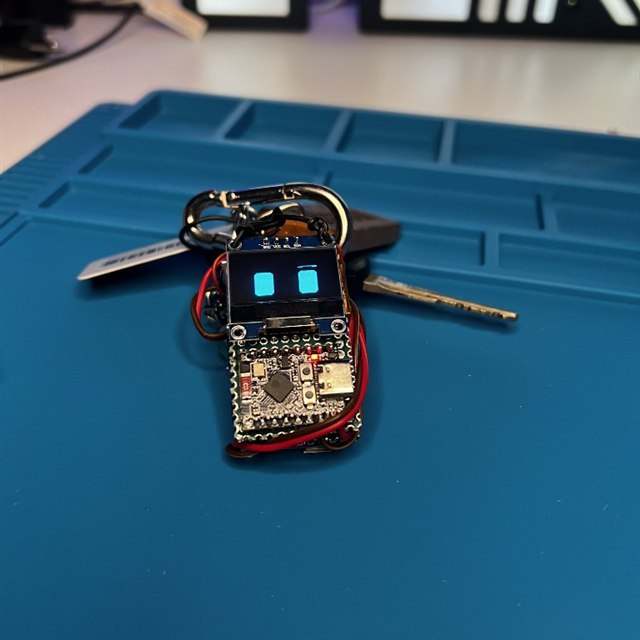
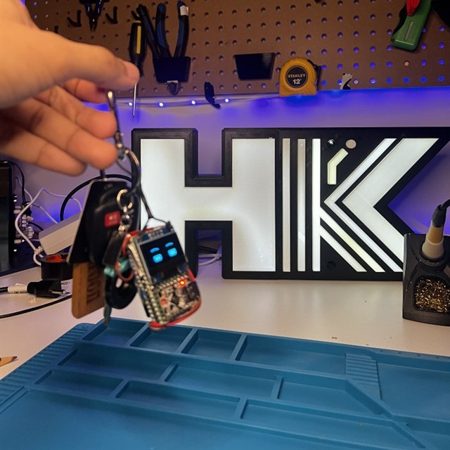
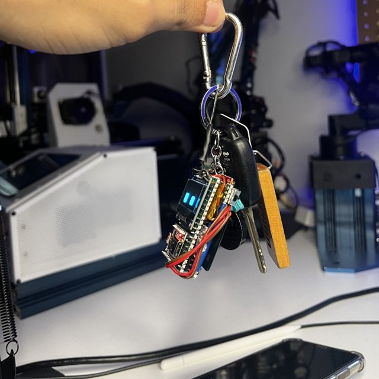
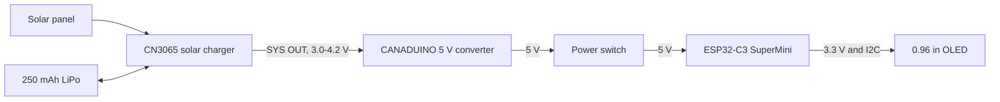
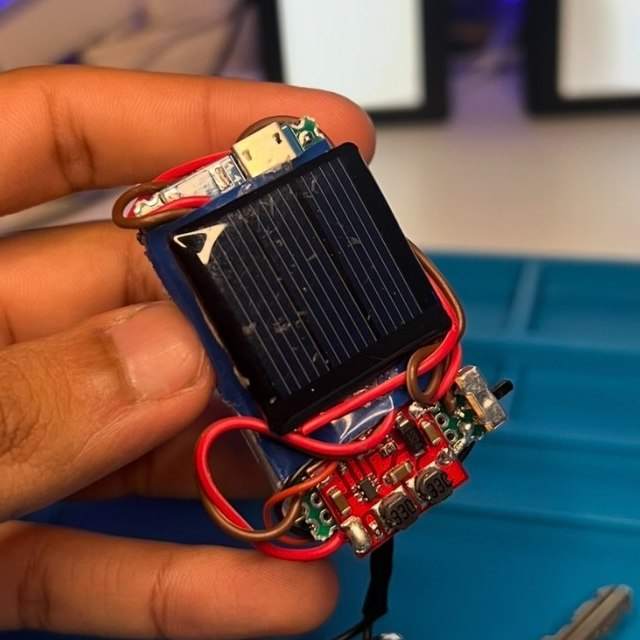
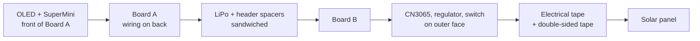
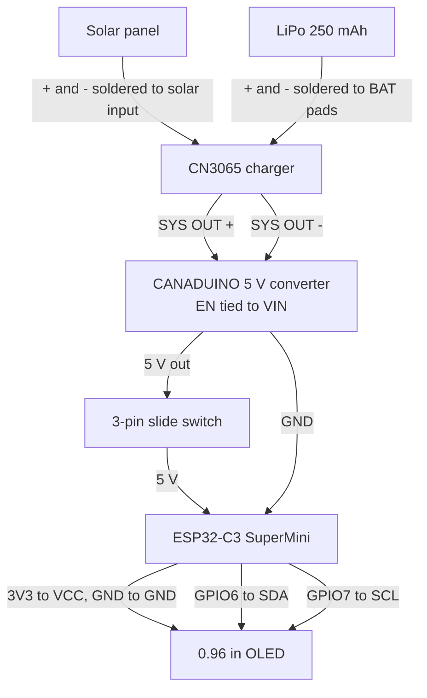
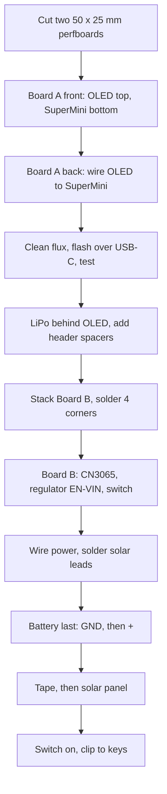
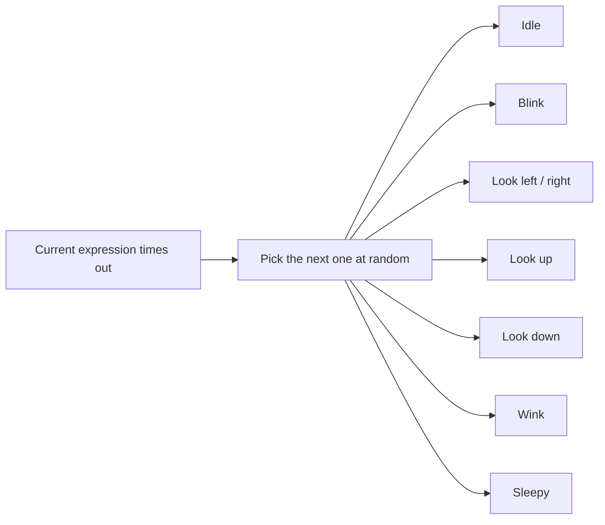

# solareyes

<table>
  <tr>
    <td></td>
    <td></td>
    <td></td>
  </tr>
</table>

Solar Eyes is a small rechargeable keychain that plays animated eyes on a 0.96" OLED. It charges from a solar panel on its back, or from the charger's Micro-USB port. There is no Wi-Fi, Bluetooth, app, or account.

The whole thing is a sandwich of two small perfboards. The front board carries the OLED and the ESP32-C3 SuperMini. The back board carries the solar charger, the 5 V regulator, and the power switch. The LiPo sits between them, and the solar panel is taped onto the outside of the back board.

## Project Status

Version 0.1 is built and running on a keychain. It boots from the battery, blinks on its own, looks around, and charges from the solar panel. Charging from the panel was confirmed with a multimeter.

This is a proof-of-concept maker build. It has no printed enclosure. The perfboards and the panel are the case.

## System Overview

The solar panel feeds a CN3065 charger, which charges a 250 mAh LiPo. The charger's SYS output follows the cell voltage, about 3.0 V to 4.2 V. A CANADUINO buck/boost converter turns that into a steady 5 V. A switch sits between the converter and the SuperMini's 5 V pin. The SuperMini's 3.3 V pin powers the OLED, and the display talks to it over I2C on GPIO6 and GPIO7.

The firmware is one Arduino sketch. It draws two rounded rectangles for eyes and moves them around with `millis()` timing.



## Bill of Materials

Prices are Amazon.ca listing prices in CAD on October 26, 2026, before tax and shipping. Most of these are multi-packs, so one order leaves spares.

| Item | Listing | Notes | Used | Price / pack |
|---|---|---|---:|---:|
| 0.96" OLED | [ELEGOO 0.96" OLED, 3-pack](https://www.amazon.ca/dp/B0D2RMQQHR) | 128 x 64, I2C, SSD1306 at address `0x3C` | 1 of 3 | C$18.99 |
| Solar panel | [MECCANIXITY mini solar panel, 5-pack](https://www.amazon.ca/dp/B0BDXBD8WM) | 1.5 V, 60 mA, 0.09 W, 30 x 30 mm | 1 of 5 | C$13.49 |
| 5 V converter | [CANADUINO mini buck/boost converter, 3-pack](https://www.amazon.ca/dp/B0BRJVF6VS) | 3-15 V in, 5 V at up to 600 mA, EN pin | 1 of 3 | C$6.99 |
| LiPo battery | [EEMB LP502030 250 mAh](https://www.amazon.ca/dp/B08FD3V6TF) | 3.7 V, 20.5 x 32 x 5.3 mm, built-in protection | 1 | C$16.99 |
| Solar charger | [CN3065 mini solar LiPo charger, 2-pack](https://www.amazon.ca/dp/B0DYZG2YLS) | 4.4-6 V solar input, Micro-USB, 500 mA charge by default | 1 of 2 | C$12.99 |
| Perfboard | [ELEGOO double-sided prototype board kit, 32 pieces](https://www.amazon.ca/dp/B072Z7Y19F) | Cut two pieces to about 50 x 25 mm | 2 pieces | C$17.99 |
| Pin headers | [Glarks 2.54 mm pin header assortment](https://www.amazon.ca/dp/B07CWSXY7P) | 10-pin male strips, used as spacers | 2 strips | C$19.96 |

**Total for the linked parts:** C$107.40.

Also needed, from parts on hand: an ESP32-C3 SuperMini, a 3-pin mini slide switch, hookup wire, double-sided tape, electrical tape, and a key ring or carabiner.

## Required Tools

| Tool | Purpose |
|---|---|
| Soldering iron and solder | All perfboard joints |
| Rosin flux | Getting solder to wet the SuperMini and header pins |
| Isopropyl alcohol (90%+) and a toothbrush | Cleaning flux off so pins do not leak current into each other |
| Multimeter | Polarity, the 5.0 V rail, and checking for shorts |
| Flush cutters / hobby knife | Cutting the perfboard and header strips |
| Wire stripper | Jumper leads |
| Arduino IDE or PlatformIO | Uploading `solar_eyes_v0_1.ino` |

## Board Layout

Both perfboards are the same size, about 50 x 25 mm. In this build, "top" means the end where the OLED is.

**Board A, front (outer face).** The OLED and the SuperMini both face outward. The SuperMini's USB-C port sticks out past the side edge so a cable can still plug in.

```text
+-------------------------+
|  +-------------------+  |
|  |                   |  |
|  |    0.96" OLED     |  |   top half
|  |                   |  |
|  +-------------------+  |
|  +-------------------+  |
|  |                   +-----+
|  |  ESP32-C3         | USB-C   <- sticks out the side
|  |  SuperMini        +-----+
|  +-------------------+  |   bottom half
+-------------------------+
```

**Board A, back.** All of the OLED-to-SuperMini wiring is done on this side. The LiPo sits behind the screen area, and the display wires wrap over it to hold it down.

```text
+-------------------------+
| ::::::::: header :::::: |   10-pin spacer strip
|  +-------------------+  |
|  |      LiPo         |  |   behind the OLED
|  |  (wires wrap over)|  |
|  +-------------------+  |
|   ~~~ I2C + power ~~~   |   neat point-to-point wiring
|   ~~~ wiring routed ~~  |
| ::::::::: header :::::: |   10-pin spacer strip
+-------------------------+
```

**Board B, outer face.** This board is only power electronics. The regulator goes at the top, behind the OLED. The switch goes in any free corner; this build uses the top right. The CN3065 is taped down with its Micro-USB port facing down.



In the photo the keychain is upside down, with the key ring end at the bottom. The red buck/boost converter and the slide switch sit at the key ring end, behind the OLED. The solar panel covers the CN3065, and the charger's Micro-USB port sticks out at the far end.

```text
+-------------------------+
|  [5V REG]          [SW] |   top, behind the OLED
|                         |
|  +-------------------+  |
|  |                   |  |
|  |  CN3065 charger   |  |
|  |                   |  |
|  +-------[uUSB]------+  |   Micro-USB facing down
+-------------------------+
```

**Side view of the stack**, from the face you look at to the back of the keychain:



## Wiring



| From | To | Notes |
|---|---|---|
| ESP32-C3 3V3 / GND | OLED VCC / GND | Display power comes from the SuperMini's 3.3 V pin. |
| ESP32-C3 GPIO6 | OLED SDA | I2C data |
| ESP32-C3 GPIO7 | OLED SCL | I2C clock |
| Solar panel + / - | CN3065 solar input + / - | Cut the JST plug off and solder the leads straight to the board. |
| LiPo + / - | CN3065 BAT + / - | Cut the JST plug off and solder straight to the board. Do this last: ground first, then positive. |
| CN3065 SYS OUT + / - | Converter VIN / GND | Battery-voltage rail into the converter. |
| Converter EN | Converter VIN | **Required.** Solder EN to VIN or the converter puts out 0 V. |
| Converter 5 V | Switch, then ESP32-C3 5 V | The switch can go in the 5 V line or the GND line. This build switches 5 V. |
| Converter GND | ESP32-C3 GND | Common ground. |

GPIO6 and GPIO7 are the pins chosen for this build. They are not a universal ESP32-C3 default, so the sketch sets them explicitly.

The SuperMini's USB-C port and its 5 V pin feed the same rail. **Flip the switch off before plugging in USB-C** to reflash, so the converter and the USB port are never both driving it.

## Assembly

### 1. Cut the two boards

Cut two pieces of perfboard, about 50 x 25 mm each. Make them the same size so they line up when stacked. Call them Board A (display side) and Board B (power side).

### 2. Mount the OLED and SuperMini on Board A

Put the OLED on the top half of Board A and the ESP32-C3 SuperMini on the bottom half. Both parts face **outward**, on the same side of the board. Let the SuperMini's USB-C port stick out past the side edge so a cable can still reach it.

Solder their pins through from the front.

### 3. Wire Board A from the back

Flip Board A over and do all the wiring on the back:

- OLED VCC to SuperMini 3V3
- OLED GND to SuperMini GND
- OLED SDA to SuperMini GPIO6
- OLED SCL to SuperMini GPIO7

Route the wires carefully and keep them tidy. Leave the display wires long enough to wrap over the battery later; they double as the battery strap.

If the solder balls up instead of sticking, add flux and hold the iron on the pin and the pad together for a couple of seconds before feeding solder in.

### 4. Clean and test Board A

Scrub the flux off with isopropyl alcohol and a toothbrush, then let it dry completely. Leftover flux can leak current between neighboring pins.

Check for solder bridges between pins. Then plug in USB-C, upload the sketch (see [Firmware](#firmware)), and confirm the eyes show up. Fixing a problem is much easier now than after the boards are stacked.

### 5. Add the battery and spacers

Lay the LiPo on the back of Board A, behind the OLED area. Do not bend, puncture, or squeeze the pouch.

Cut 10-pin, 2.54 mm single-row male header strips. These are the same headers the SuperMini uses to plug into a breadboard; here they are just spacers. Ten pins is about 25 mm, the width of the board. Solder one strip along each short edge of Board A so the boards will sit far enough apart for the battery.

Wrap the display wires over the battery so they hold it in place.

### 6. Stack Board B

Put Board B on top of the header pins and line it up with Board A. Solder the four corner pins to Board B. The battery is now sandwiched between the two boards.

### 7. Mount the power parts on Board B

On the outer face of Board B:

1. Stick the CN3065 charger down with double-sided tape, Micro-USB port facing down.
2. Mount the CANADUINO 5 V converter at the top, behind the OLED. **Solder EN to VIN** on the converter.
3. Mount the 3-pin slide switch in any free corner. This build uses the top right corner. Use the middle pin and one outer pin.

### 8. Wire the power board

1. Run CN3065 SYS OUT + and - to the converter VIN and GND.
2. Run the converter 5 V out through the switch to the SuperMini 5 V pin.
3. Run the converter GND to the SuperMini GND pin.
4. Cut the JST plug off the solar panel and solder its + and - leads straight to the CN3065 solar input.

### 9. Connect the battery last

Wire the battery last so you are never soldering on a live circuit.

1. Set the switch to off.
2. Cut the JST plug off the LiPo.
3. Solder the **ground** lead to CN3065 BAT - first. Leave the positive lead floating and insulated.
4. Solder the **positive** lead to CN3065 BAT + last.
5. With the switch still off, meter the converter's 5 V output to ground. It should read about 5.0 V.

### 10. Mount the solar panel

Cover the CN3065 with electrical tape. Put double-sided tape on top of the electrical tape, then stick the solar panel onto it. The electrical tape keeps the panel's back from touching anything on the charger board.

### 11. Switch it on

Flip the switch on. The eyes should come up within a second. Clip it onto your keys.



## Firmware

`solar_eyes_v0_1.ino` is the whole firmware. U8g2 draws into a 128 x 64 framebuffer in RAM, and the sketch pushes that buffer to the SSD1306 itself over I2C at 100 kHz. This panel did not respond at the library's default 400 kHz.

Arduino IDE settings for the SuperMini:

| Setting | Value |
|---|---|
| Board package | esp32 by Espressif Systems |
| Board | ESP32C3 Dev Module |
| USB CDC On Boot | Enabled |
| Library | U8g2 by oliver |

```cpp
#define SDA_PIN 6
#define SCL_PIN 7
#define OLED_ADDR 0x3C

void oledInit() {
  Wire.begin(SDA_PIN, SCL_PIN);
  Wire.setClock(100000);
  // ...SSD1306 init sequence, then display on
}
```

Each eye is a filled rounded rectangle with no pupil. The eye looks around by changing shape. When the face turns to one side, the near eye gets a little bigger, the far eye a little smaller, and the two slide closer together. Arched eyebrows move with each eye, and the eyes bob slightly while idle. Every change eases in over a few frames instead of snapping.

The top 16 rows of this panel are yellow glass. The sketch keeps those rows dark, so only blue pixels light up.



The loop redraws about every 33 ms and pauses briefly between frames so the USB connection stays alive. Wi-Fi and BLE are never started.

## Notes and Limitations

Version 0.1 is a proof of concept, and it has known rough edges. Future versions will attempt to resolve these in some capacity.

- **Solar charging is slow.** The 30 x 30 mm panel is small, so charging from light alone takes a long time. The charger's Micro-USB port is much faster.
- **Charge current is high for this cell.** The CN3065 board charges at up to 500 mA by default. The EEMB cell's maximum charge current is 250 mA. Changing the charger's program resistor would bring it down to about 125 mA.
- **No radio features.** There is no Wi-Fi, BLE, microphone, cloud, or phone app.
- **USB-C and the 5 V pin share one rail.** Switch off before plugging in USB-C to reflash.
- **The serial port drops on reset.** When the ESP32 reboots, Windows drops and re-adds its USB serial port. Close the serial monitor before uploading.
- **Small standby drain.** With the switch in the 5 V line, the converter still draws about 0.2 mA from the battery when the keychain is off.
- **The battery is exposed.** The pouch cell has no case around it. Keep it from being pinched or punctured on the key ring.

## Future Improvements

- Film the full build and the reveal
- A larger solar panel for faster charging
- A lower charge current to match the 250 mAh cell
- Add a thin printed bumper around the edges
- Battery-level reading on an ADC pin
- Sleep between expressions to stretch battery life
- More expressions

## References

- [U8g2](https://github.com/olikraus/u8g2) and the [C++ setup guide](https://github.com/olikraus/u8g2/wiki/u8g2setupcpp)
- [CANADUINO mini buck/boost converter](https://www.amazon.ca/dp/B0BRJVF6VS)
- Earlier project in the same style: [robotictentacle](https://github.com/hronkrobotics/robotictentacle)
- CN3065 datasheet, the EEMB LP502030 cell drawing, and the ESP32-C3 SuperMini pinout. Check the silkscreen on your own boards before applying power.

## Disclaimer

This is a small LiPo project. Check polarity and the 5 V rail with a meter before connecting the microcontroller. Do not charge a damaged or swollen pouch, and do not solder on the circuit while the battery's positive lead is connected.
