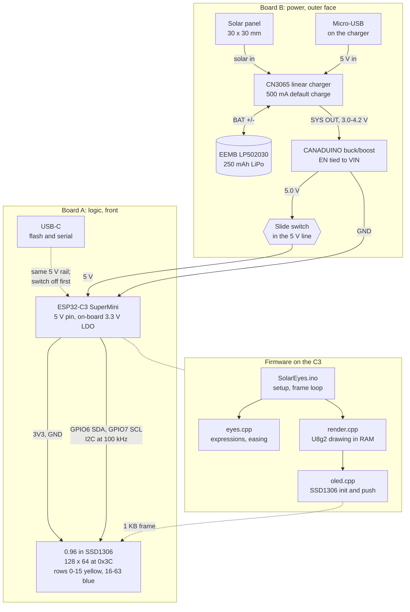
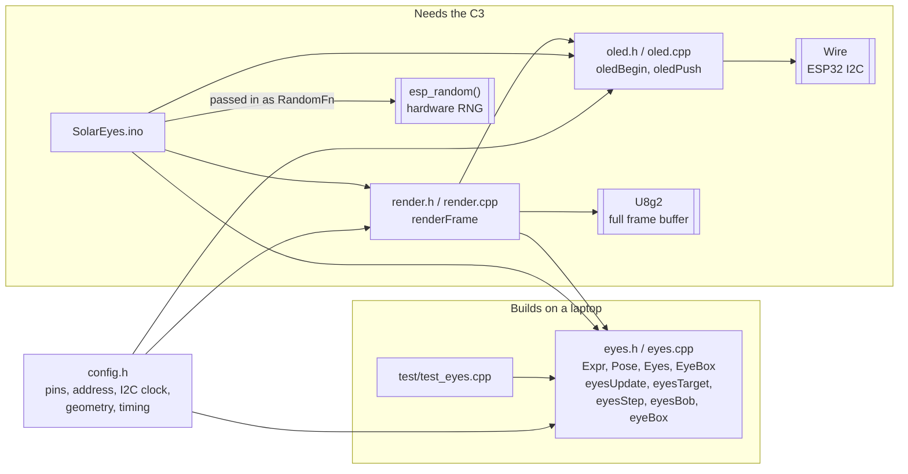
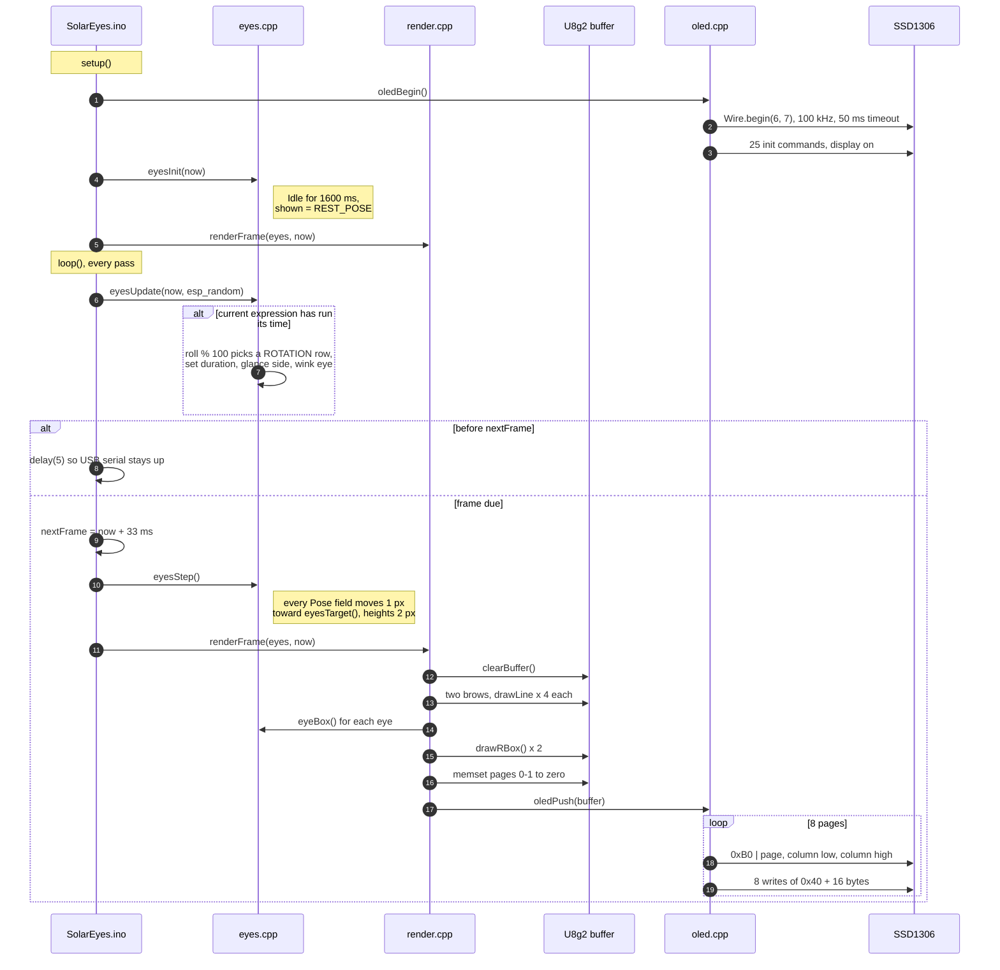
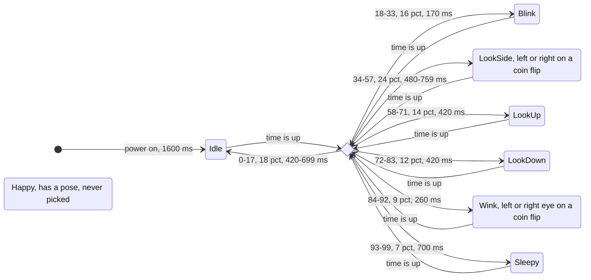
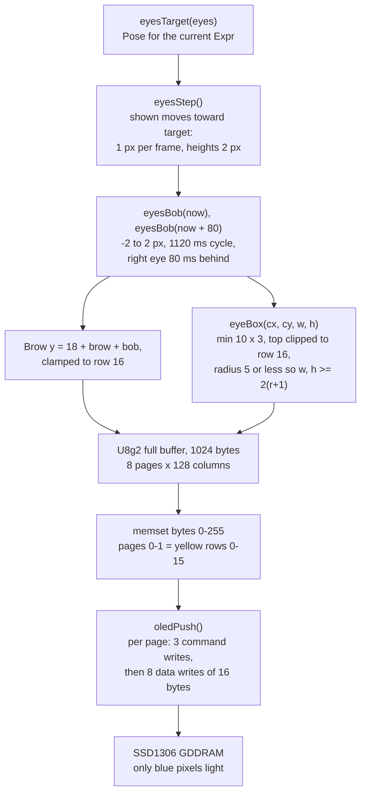

# How Solar Eyes works

This page follows the keychain from the solar panel to a lit pixel. The wiring and the build steps are in the [README](../README.md). Where to change things is in [CONTRIBUTING.md](../CONTRIBUTING.md).

## The whole keychain

Power flows down Board B, and data flows across Board A. The firmware blocks are the files in `firmware/SolarEyes/`.

## Firmware files

`eyes.cpp` holds all the decisions and no hardware. It is the part `make test` builds on a laptop.

`eyesUpdate()` takes the random source as a function pointer. The sketch passes `esp_random`, and the tests pass a scripted list of numbers, so every branch of the rotation can be checked.

## Boot and one frame

## Expressions

Each expression runs for its time, then a roll from `esp_random() % 100` picks the next one. The same expression can come up twice in a row. `Happy` has a pose in `eyesTarget()` but is not in `ROTATION` yet, so it never appears.

What each expression asks for, relative to rest (each eye 26 x 34 px, brow arch 4):

| Expression | Eyes | Brows |
| --- | --- | --- |
| Idle | rest | rest |
| Blink | both 4 px tall | down 2, arch 2 |
| LookSide | near eye 28 x 36, far eye 23 x 31, both slide 2 and 8 px toward the side | near brow up 1, arch 5 / 3 |
| LookUp | up 2, 36 px tall | up 2, arch 5 |
| LookDown | down 3, 26 px tall | down 2, arch 2 |
| Wink | one eye 4 px tall, nudged 2 px inward | that brow down 1, arch 2 |
| Sleepy | down 2, 22 px tall | down 2, arch 2 |
| Happy | 28 x 32 | up 2, arch 5 |

## From pose to pixels

U8g2's full buffer and the SSD1306 share one layout: byte `page * 128 + column` holds 8 pixels stacked vertically, with bit 0 on top. That match is what lets `oledPush()` send the buffer straight through.

## I2C budget per frame

At 100 kHz each byte on the wire costs 9 bit times, or 90 µs.

| Part | Transactions | Bytes on the wire, address included |
| --- | ---: | ---: |
| Page and column commands | 24 | 72 |
| Pixel data, 16 bytes at a time | 64 | 1,152 |
| **Total** | **88** | **1,224, about 110 ms** |

That is the floor before any ESP32 driver overhead, and it is more than the 33 ms `FRAME_MS`. The loop starts the next frame as soon as the push finishes, so the panel updates at about 9 frames a second, not 30. Set `DEBUG_FRAME_TIME` to `1` in `config.h` to print the real push time over serial.

The easing is counted in frames, so a 170 ms Blink gets one or two steps before the next expression starts. The eyes dip from 34 px to about 30 px instead of closing. Pages 0-1 are always blank, so skipping them in `oledPush()` after the first frame would save a quarter of the bus time.
